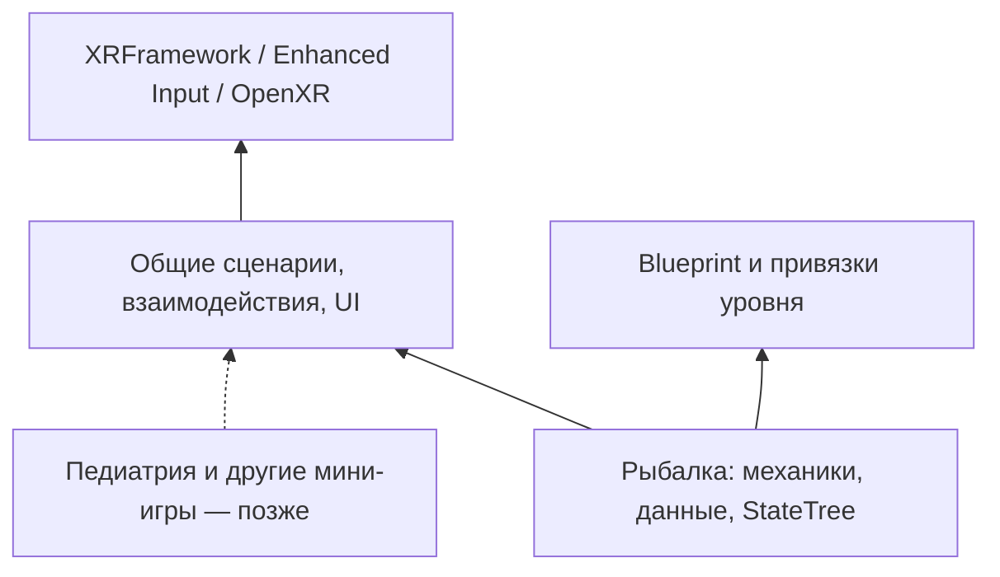

# План перехода к общей архитектуре мини-игр

Статус: предложение для обсуждения, реализация не начата. Дата: 07.11.2026. Область работ: общие системы PCVR и перенос работающей рыбалки на них. Педиатрия и другие мини-игры сейчас не реализуются.

## 1. Цель и исходная версия

Дизайнер должен настраивать баланс, контент, задания, последовательность этапов, переходы, сообщения и оформление через Unreal Editor без изменения C++. Программист предоставляет механики, проверяемые операции и расширяемые интерфейсы.

Рабочую рыбалку сохраняем как исходный образец поведения. Последний отчёт `YakutSimulator/Saved/FishingPrototype/controls-ui-results.json` содержит восемь успешных тестов, включая полную смену. При миграции сохраняем текущие настройки управления и исправление случайного нажатия соседнего СТОП.

План основан на прочитанных C++-классах, настройках проекта и составе Content. В проекте найдены `BP_XRPawn`, `BP_XRGameMode`, `BP_GrabComponent`, Input Actions и Mapping Contexts из XRFramework. Их графы через MCP сейчас прочитать не удалось: сервер вернул HTTP 502. Проверка этих графов — обязательный первый шаг перед изменением владельца ввода и захвата. Редактор в ходе планирования не запускался и не перезапускался.

Исходные ограничения: одиночный PCVR, один активный сценарий для игрока. Контекст конкретного запуска передаётся явно; общий код не обращается к «первой найденной рыбалке» в мире.

## 2. Что сейчас смешано

| Текущий класс | Содержимое | Направление разделения |
|---|---|---|
| `AFishingScenario` | Этапы, ввод, перемещение игрока, лебёдка, конвейер, обработка, результаты, тексты | Общий жизненный цикл, StateTree рыбалки, отдельные механики рыбалки, данные и UI |
| `UFishingInteractionComponent` | Enhanced Input, поиск рук и целей, проверки фокуса, прямые обращения к классам рыбалки | Общий interactor на Pawn и интерфейс взаимодействия |
| `AFishingStation` | Кнопки, рычаг, приёмники, табло, команды рыбалки, цвета и размеры текста | Общие компоненты кнопки, рычага и приёмника; отдельное представление; привязки к рыбалке |
| `AFishingItem` | Рыба и нож в одном классе, захват, физика, возврат, сортировка и обработка | Общие возможности предмета; отдельное состояние рыбы и настройка инструмента |
| `FishingLog` | Общая диагностика ввода и специальное состояние рыбалки | Общие категории взаимодействий/сценариев и отдельный `LogFishing` |
| `FishingTextAssets` | Подготовка шрифта и материала через редакторскую команду | Подготовленные общие UI-ассеты и Editor-only инструменты |

Уже доступны часть параметров: размер улова, длительности этапов, скорость ленты, интервал подачи, допуск обработки, ход рычага и радиус поиска. Их переносим в согласованную схему данных, сохраняя значения.

Среди оставшихся чисел в C++: дистанция кнопки 8 см, нейтраль рычага 2 см, разгон 0,75/с, пороги нагрузки 0,8/0,9, задержка перегрузки 1,5 с, глубина сети 500 см, возврат предмета через 5 с или ниже условной границы на 150 см, дистанция удержания рыбы 30 см, максимальный скачок ножа 40 см, времена затемнения 0,12/0,15 с. В коде также закреплены два вида рыб A/B, две траектории обработки, чередование видов, тексты, шрифты, цвета и части размещения UI.

Начальные трансформы некоторых Scene Components уже можно менять в редакторе. Их не нужно дублировать ещё и глобальными координатами в Data Asset.

## 3. Где дизайнер редактирует логику

| Вид настройки | Единственный источник |
|---|---|
| Баланс и правила конкретной механики | Типизированные структуры в Data Assets |
| Порядок этапов, ветвления, условия переходов, действия входа/выхода | StateTree сценария и его параметры |
| Особые действия/условия, отсутствующие среди готовых механик | Расширяемые Blueprint Tasks/Conditions |
| Тексты задач, отказов и результатов | `FText`, String Tables и записи задач |
| Геометрия, материалы, сокеты, точки захвата и объёмы взаимодействия | Blueprint предмета/станции |
| Положение рабочих мест, лотков, точек появления и путей | Ссылки и компоненты на уровне |
| Представление интерфейса | Общие Widget Blueprint, стиль и размещённые Widget Components |
| Текущее состояние прохождения | Runtime-объекты текущего запуска |

StateTree поддерживает состояния, условия, переходы, параметры и расширение через Blueprint. Для этого проекта предлагается использовать его как редактор последовательности сценария. [Документация Epic](https://dev.epicgames.com/documentation/en-us/unreal-engine/overview-of-state-tree-in-unreal-engine).

В установленном UE 5.8 найдены `StateTree` и `GameplayStateTree`. При реализации зафиксировать необходимые плагины и зависимости `StateTreeModule`/`GameplayStateTreeModule` в проекте. Отдельный собственный редактор сценарных графов не требуется.

В Data Assets храним настройки; они не содержат изменяемый прогресс, ссылки на созданные рыбы или активные таймеры. Состояние создаётся отдельно на каждый запуск. Настройки прохождения применяются при его старте/перезапуске, что обеспечивает воспроизводимость. [Data Assets в Unreal](https://dev.epicgames.com/documentation/unreal-engine/data-assets-in-unreal-engine?application_version=5.8).

Из C++ выносятся игровые решения и авторские настройки. Проверки корректности, нормализованный диапазон 0–1 и математические допуски остаются частью реализации. Новая механика может потребовать кода; изменение настройки или сочетания уже существующих механик — нет.

### Визуальное представление задаёт дизайнер

Это обязательное требование архитектуры, подтверждённое пользователем. У каждого видимого игрового объекта есть представление, настраиваемое через Unreal Editor. Финальные меши, материалы и оформление уровней добавляет дизайнер; механики продолжают работать с назначенными компонентами и привязками.

- Для обычной геометрии используются доступные в Blueprint/Details `StaticMeshComponent`, для скелетного представления — `SkeletalMeshComponent`. Составной объект может содержать несколько визуальных компонентов: например, основание и рукоятка рычага назначаются отдельно. Интерфейс задаётся Widget Blueprint и Widget Components.
- Основной источник визуала — Blueprint объекта: меши, материалы, относительные трансформы и анимационные настройки. Определение вида/контента ссылается на этот Blueprint-класс. Не дублируем назначение одного меша одновременно в Blueprint и Data Asset.
- Механика получает явную ссылку на нужный компонент: перемещаемую рукоятку, сеть, рабочую часть инструмента и т. п. В коде нет выбора модели по имени ассета, номеру вида или пути `/Engine/BasicShapes/`.
- Состояния объекта могут менять его внешний вид через настроенные дизайнером представления и Blueprint-события. Ссылки на варианты мешей, материалы, анимации и эффекты тоже назначаются в Editor. `BeginPlay`, `OnConstruction` и `Tick` не подменяют выбранный дизайнером визуал, материалы или масштаб встроенными моделями.
- Коллизии, объёмы нажатия/приёма, точки захвата, pivot рычага, кончик ножа, траектория обработки и anchors настраиваются отдельно и видны в Editor. Замена декоративного меша пульта не увеличивает область кнопки СТОП. Для модели с другими размерами или осями дизайнер корректирует эти привязки без изменения C++.
- Unreal-примитивы назначаются в тестовых Blueprint тем же способом, что и финальные модели. Они являются заменяемым тестовым контентом. Runtime-код не создаёт их как скрытую подмену отсутствующего обязательного ассета.
- Декорации корабля и рабочих помещений размещаются дизайнером в уровне. Функциональные акторы/компоненты можно встроить в декорированный пульт, конвейер или стол через ссылки и компоненты, без переписывания механик. Автогенератор тестовой карты не перезаписывает авторский уровень.
- Проверка данных обнаруживает отсутствие обязательного визуала или привязки до запуска. Чисто логические сценарии и компоненты могут не иметь меша; визуальное оформление не добавляется им искусственно.

## 4. Общие классы и контракты

Имена ниже — предлагаемые. Разделение обязанностей важнее окончательного написания имён.

### Сценарий и запуск

- `AMiniGameScenario`: запуск, завершение, прерывание, повтор, контекст текущего запуска и общие события. Содержит StateTree Component и ссылку на определение мини-игры.
- `UMiniGameDefinition`: стабильный идентификатор, название, сценарный StateTree, ссылки на нужные классы/контент и оформление. При необходимости регистрации и загрузки используем штатный `UPrimaryDataAsset` и Asset Manager без собственного менеджера загрузки.
- Общий контекст: игрок, текущий сценарий, идентификатор запуска, активная задача. Зависимости назначаются при инициализации.
- Общие события: начало/конец запуска, смена задачи, прогресс, доступность действия, обратная связь. Идентификаторы действий и задач — Gameplay Tags; отображаемые названия задаются отдельно.

В общих типах отсутствуют поля улова, виды рыб, диагнозы и медицинские решения. Подробные результаты рыбалки принадлежат рыбалке; общая оболочка предоставляет жизненный цикл, время и место для специализированных результатов.

### Взаимодействия

- `UXRInteractorComponent`: единая обработка Grab/Release/Use, поиск цели и удерживаемый объект для каждой руки. Input Actions, ссылки на руки, параметры поиска и приоритеты настраиваются. Компонент не знает типов и этапов рыбалки.
- `IInteractable`: проверка доступности с причиной отказа, начало/конец взаимодействия, дискретное действие, данные подсказки. Предмет или механика сами определяют свои ограничения.
- Общий компонент захвата: привязка к руке, точка/сокет захвата, сохранение смещения или snap, управление физикой и освобождение при потере tracking/фокуса. Сначала проверить `BP_GrabComponent`; использовать или расширить его через адаптер, если он покрывает нужное поведение. В проекте должен остаться один владелец захвата и одна цепочка обработки каждого действия.
- `UPressableInteractionComponent`: нажатие и доступность кнопки, отдельный явно настроенный объём нажатия. Объём не зависит от размеров декоративной модели всего пульта.
- `ULeverInteractionComponent`: ось, диапазон хода, нейтраль, разгон, привязка рукоятки к руке, возврат и событие нормализованного значения. Компонент не знает о трале, нагрузке и остановке лебёдки.
- `UItemReceiverComponent`: объём приёма, запрос проверки и событие результата. Правила «какая рыба в какой лоток» задаёт рыбалка.
- Возможность возврата потерянного предмета: настраиваемые условия, время и точка возврата; специальное сохранение прогресса рыбы обрабатывает её собственная логика.

Правила доступа проверяются при выполнении действия, а не только подсветкой UI. Проверка предмета другого сценария или предыдущего запуска остаётся обязательной.

### Перенос игрока, UI и диагностика

- Общая операция перемещения к рабочему месту: ссылка на anchor, поправка на смещение HMD и пол, затемнение, отмена при завершении сценария. Перед выделением нового компонента проверить возможности существующего Pawn/телепорта XRFramework.
- Общие Widget Blueprint: задача, подсказка взаимодействия, сообщение результата и оболочка итогов. Рыбалка предоставляет свои виджеты скорости/нагрузки и данные улова.
- UI получает изменения через события. Частые числовые показатели обновляются с заданной частотой; игровая логика не устанавливает каждый кадр шрифт, позицию, цвета и полный текст интерфейса.
- Общий стиль содержит шрифты, размеры, цвета состояний и ссылки на звук/вибрацию при их использовании. Текущие шрифт и материал кириллицы переводятся в общие UI-ресурсы с сохранением ссылок.
- Сохраняем подробные логи: мини-игра, запуск, задача, рука, объект, действие, результат и код причины. Общий ввод выводится в `LogInteraction`, жизненный цикл — в `LogMiniGame`, специальные данные — в `LogFishing`. Используется штатный Output Log.

Пример связи компонентов:

```text
Кнопка → событие сценария → StateTree → новая задача → общий UI
Рычаг → значение 0–1 → механизм лебёдки → прогресс/остановка → StateTree и UI
Приёмник → проверка рыбалки → результат сортировки → прогресс задачи
```

## 5. Что остаётся в рыбалке

`AFishingScenario` наследует общий сценарий и связывает свои механики. Из него последовательно выделяются логика лебёдки, конвейера/улова и обработки. Это могут быть Actor Components на существующих станциях; не требуется создавать отдельный Actor для каждой функции.

| Часть рыбалки | Настройки и специальные правила |
|---|---|
| `UFishingDefinition` | Набор видов, состав партии, настройки механизмов, ссылки на представление и специальные правила результатов |
| Механизм лебёдки | Длительности выпуска/подъёма/траления, глубина, модель нагрузки и её параметры, предупреждение, порог и задержка остановки, правила сброса |
| Конвейер и улов | Порядок или распределение видов, размер партии, скорость, интервал появления, положение и шаг возврата, обработка пропуска |
| Определение вида рыбы | Идентификатор, имя, класс/визуальное представление, правила сортировки и обработки |
| Обработка | Редактируемая траектория, допуски, рабочая точка инструмента, необходимость придерживания и ограничения движения |
| Специальное состояние рыбы | Подача, сортировка, положение на столе, прогресс обработки, сдача, однократный учёт ошибок |
| Результаты рыбалки | Обработанный и сданный улов, пропуски, ошибки, перегрузки и настраиваемые правила оценки |

Виды A/B заменяются ссылками на определения видов, чтобы третий вид добавлялся ассетами. Перечисление состояний рыбы может остаться внутренним техническим типом; число видов и их правила через него не задаются.

Траекторию обработки дизайнер редактирует визуально, например Spline Component в Blueprint рыбы. Положение станции задаётся уровнем. Не дублируем одно и то же значение одновременно в профиле вида, Blueprint и свойствах уровня.

Сценарная цепочка текущей рыбалки переносится в `ST_Fishing_Default`: подготовка → выпуск → траление → подъём → сортировка → обработка → результаты. Переходы и входные/выходные действия принадлежат StateTree. Механики сообщают факты выполнения и причины отказов. Остановка лебёдки остаётся восстановимым состоянием механизма, а не завершением всей мини-игры.

Отключаемые элементы, например перегрузки, получают явные настройки. Их отключение должно изменять и поведение, и подсказки, и условия прохождения.

## 6. Организация проекта

Начинаем с логического разделения в существующем runtime-модуле, сохраняя стабильность проекта и ссылок. Отдельный распространяемый plugin и Game Features сейчас не нужны.

```text
Source/YakutSimulator/
  Public/Common/              # сценарий, интерфейсы, взаимодействия, общие данные
  Private/Common/
  Public/Fishing/             # механики и специальные данные рыбалки
  Private/Fishing/
  Private/Tests/

Content/
  Common/                     # общий UI, профили, взаимодействующие предметы
  MiniGames/Fishing/          # StateTree, профили, Blueprint, игровая карта
  Tests/                      # самостоятельные проверочные ассеты и сцены
  XRFramework/                # существующая XR-основа
```

Физическое перемещение Content выполняется после переноса поведения, с redirectors и проверкой всех ссылок. Перенос файлов C++ в папки не требует переименовывать UCLASS. При изменении имён классов или свойств заранее определить миграцию/Core Redirects.

Editor-only генераторы и импорт шрифтов отделяются от runtime-кода; отдельный Editor-модуль вводится, когда в него действительно переносятся эти инструменты. Игра не должна зависеть от выполнения редакторской консольной команды перед запуском.

Текущая рыбалка остаётся стартовым содержимым проекта. Стартовый уровень настраивается через настройки проекта; launcher не должен скрыто подменять его путём рыболовной карты. Выбор мини-игры и отдельное меню/хаб в эту работу не входят.



Зависимость общих классов от `Fishing` запрещена. В первую очередь это проверяется составом заголовков и сборкой; выделение самостоятельных runtime-модулей можно выполнить при появлении практической необходимости.

## 7. Порядок миграции

| Этап | Работа | Проверяемый результат |
|---|---|---|
| 0. Зафиксировать исходник | Сохранить рабочую ревизию и пресет текущих настроек; проверить графы XRFramework, владельцев ввода, действующие ссылки и карту | Определён один путь ввода/захвата; исходная версия проходит существующие проверки |
| 1. Вынести настройки | Создать типизированные профили, определения видов и Blueprint с назначаемыми мешами; перенести существующие числа и ссылки без изменения поведения | Скорость, пороги, состав партии и оформление меняются без C++; примитивы назначены тестовым ассетам через Editor |
| 2. Выделить взаимодействия | Перенести interactor и общий контракт; адаптировать захват, кнопку, рычаг и приёмник; сохранить защиту от соседнего СТОП | Рыбалка использует общий ввод; нет двух систем захвата и двойных обработчиков |
| 3. Разделить механику и сценарий | Выделить жизненный цикл, перенос игрока и специальные механики; перенести цепочку в StateTree | Очерёдность и ветвления редактируются в StateTree; общий код не знает классов рыбалки |
| 4. Вынести представление | Перевести задачи, подсказки и результаты на общие Widget Blueprint и данные; удалить установку оформления из Tick | Дизайнер меняет тексты, вид и размещение UI; причины отказа отображаются единообразно |
| 5. Завершить миграцию | Обновить Blueprint, сцену, ссылки, документацию, запуск и cook-настройки; удалить временные адаптеры | Одна действующая реализация; рыбалка запускается в Editor и в собранной игре |

После каждого изменения механики выполняются соответствующие тесты. Полное прохождение карты — на границах миграционных этапов. Не переключаем всю рыбалку на новую архитектуру одним изменением без промежуточной проверки.

Текущая карта прототипа остаётся контрольной. Рабочую карту сначала создаём как её копию; автоматическая генерация не перезаписывает авторский уровень. Старые публичные точки входа при необходимости временно перенаправляются в новую реализацию, затем удаляются после миграции потребителей.

## 8. Валидация и критерии готовности

Используем штатную валидацию данных Unreal для определений и конфигурации: обязательные ссылки, корректные диапазоны, уникальные идентификаторы, существующие виды/приёмники, непустые траектории, необходимые anchors. При старте выполняются проверки runtime-контекста с понятным сообщением. [Data Validation](https://dev.epicgames.com/documentation/en-us/unreal-engine/data-validation-in-unreal-engine).

Критерии приёмки:

1. В общих классах нет зависимостей от `AFishingScenario`, видов рыб и этапов обработки.
2. Designer-facing параметры доступны в данных/ассетах с единицами измерения, названиями и проверками диапазонов; runtime-прогресс отделён от настроек.
3. Третий вид рыбы с другим визуалом и траекторией обработки добавляется без изменения C++ и enum видов.
4. Второй профиль рыбалки меняет размер/состав партии, настройки лебёдки, перегрузки, ленты, допуски и сообщения без правок механик.
5. Добавление промежуточного задания, изменение перехода или отключение опционального этапа выполняется в StateTree и данных. Сценарные ограничения не дублируются скрытым `switch` в другом классе.
6. Общие взаимодействия проходят самостоятельные тесты с простыми тестовыми объектами, не использующими рыболовные классы. Для этого не реализуется педиатрия.
7. Сохраняются проверки захвата/отпускания, второй руки, фокуса/tracking, соседнего СТОП, сброса, сортировки, восстановления предметов, обработки, сдачи и повтора смены.
8. Два запуска, использующие один профиль, не меняют состояние друг друга. Перезапуск отменяет старые таймеры/подписки, освобождает руки и удаляет созданные объекты; поздний callback прошлого запуска игнорируется.
9. Проверены ссылки, упаковка и запуск собранной PCVR-версии. Soft references включены в cook штатными правилами; нет runtime-зависимости от UnrealEd или файлов внутри Saved.
10. На целевом VR-комплекте отдельно проверены досягаемость, калибровка рук, читаемость UI и стабильность кадров. Работа в симуляторе не заменяет эту проверку.
11. Дизайнер заменяет тестовые меши рыбы, ножа, рукоятки, сети и станций, назначает материалы и настраивает привязки через Editor. Запуск, повтор и смена этапа сохраняют выбранные модели, масштаб и оформление.
12. Функциональные объекты работают на декорированной копии уровня без C++-координат корабля и зависимости от размеров декоративных мешей. Проверены коллизии, точки захвата, рабочие точки инструментов и области кнопок после замены визуала.

Формальная проверка отсутствия любых чисел в C++ не является критерием: технические инварианты и фиксированные данные тестов остаются в коде. Критерий — возможность изменить согласованные игровые решения и контент в редакторе без переписывания общих систем.

## 9. Границы текущей работы

Сейчас не добавляются педиатрические пациенты, диагнозы и медицинские инструменты, новые мини-игры, сетевой режим, профильное сохранение прогресса между запусками, меню выбора/хаб, внешняя телеметрия и собственный редактор сценариев. Также эта миграция не включает создание финальных моделей корабля и рыбы.

Архитектура оставляет эти расширения отдельным содержимым и специализированной логикой. Переиспользуемость подтверждается независимыми тестами общих систем, а не предположениями о ещё не реализованной медицине.
